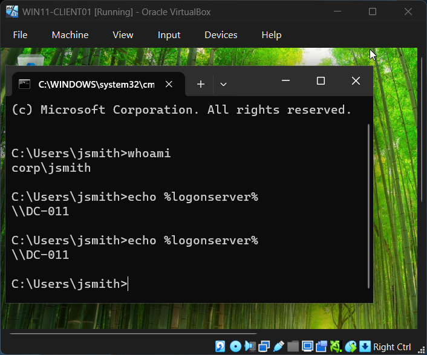
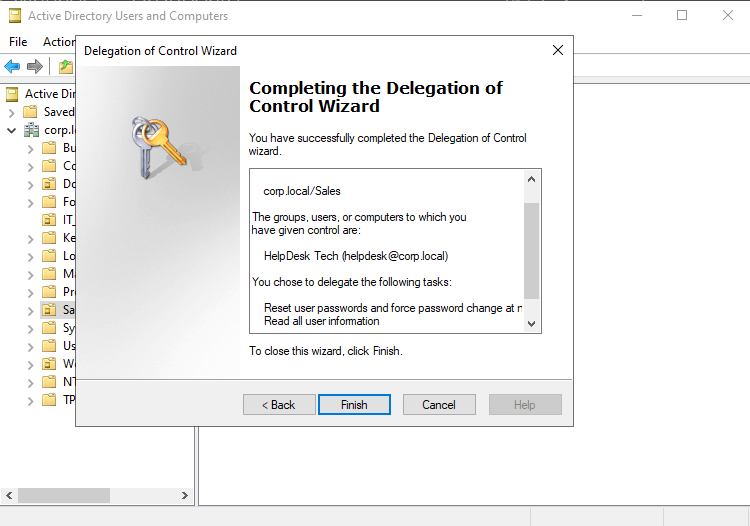
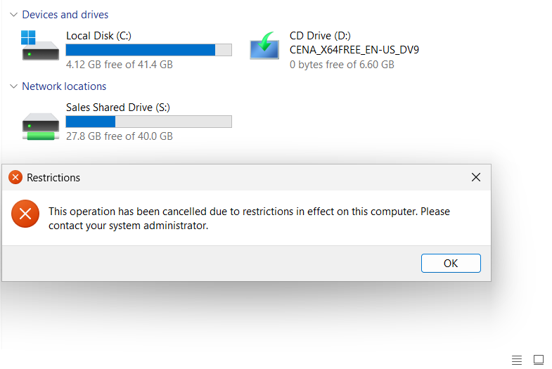
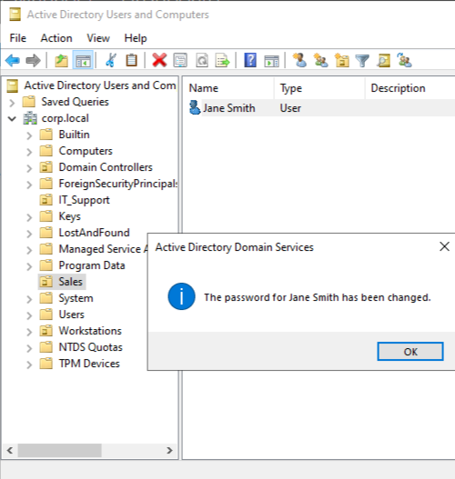

# Active Directory & Help Desk Ticketing Home Lab

## Project Overview
This home lab simulates an enterprise Windows network built from scratch in **Oracle VirtualBox**. It demonstrates core Tier 1/Tier 2 IT support and system administration workflows, including Domain Controller deployment, static internal networking, Role-Based Access Control (RBAC), Group Policy management, and structured Help Desk ticket resolution.

---

## Lab Architecture & Network Topology

| Component | Role | Hostname | Internal IP (`Domain-LAN`) | Operating System |
| :--- | :--- | :--- | :--- | :--- |
| **Domain Controller** | AD DS, DNS, File Server | `DC-011` | `192.168.10.10` | Windows Server Evaluation |
| **Client Workstation** | Domain-Joined Endpoint | `WIN11-CLIENT` | `192.168.10.20` | Windows 11 Enterprise |

* **Domain Name:** `corp.local` (NetBIOS: `CORP`)
* **Network Segmentation:** Dual-NIC architecture separating external internet traffic (`Internet-NAT`) from an isolated internal corporate subnet (`192.168.10.0/24` on `Domain-LAN`).

---

## Implementation Phases

### Phase 1: Domain Controller Promotion & Workstation Join
1. Configured static IPv4 addressing (`192.168.10.10`) and loopback DNS (`127.0.0.1`) on `DC-011`.
2. Installed **Active Directory Domain Services (AD DS)** and **DNS Server** roles, promoting `DC-011` to a new forest root (`corp.local`).
3. Joined the Windows 11 client workstation to `corp.local` and verified end-to-end authentication using command-line diagnostics (`whoami` and `echo %logonserver%`).

---

### Phase 2: Organizational Structure & Least Privilege Delegation (RBAC)
1. Created structured Organizational Units (**`Sales`** and **`IT_Support`**) to separate standard end-users from administrative accounts.
2. Provisioned a standard employee account (`CORP\jsmith` — Jane Smith) in `Sales` and a dedicated Tier 1 technician account (`CORP\helpdesk`) in `IT_Support`.
3. Applied the **Principle of Least Privilege** using the Delegation of Control Wizard, granting `helpdesk` permission to reset passwords and read user information strictly within the `Sales` OU without granting full Domain Admin rights.

---

### Phase 3: Group Policy Objects (GPO) & Workstation Hardening
Created and linked two Group Policy Objects to the `Sales` Organizational Unit:
* **Automated Network Drive Mapping (`Map Sales Shared Drive`):** Configured a shared network directory (`\\DC-011\Sales_Data`) with matching Share (`Change`) and NTFS (`Modify`) permissions for `Domain Users`, automatically mapping it as drive **`S:`** upon login.
* **Endpoint Security Hardening (`Restrict Control Panel`):** Enabled *Prohibit access to Control Panel and PC settings* under User Configuration to prevent unauthorized system modifications by standard users.

---

### Phase 4: Simulated Help Desk Ticket Resolution

#### Ticket #001 — Forgotten Domain Password Reset
* **User:** Jane Smith (`CORP\jsmith`)
* **Issue:** User reported inability to sign in to her Windows 11 workstation due to a forgotten password.
* **Troubleshooting & Resolution:**
  1. Verified user identity and located `Jane Smith` inside the `Sales` Organizational Unit in Active Directory Users and Computers (`dsa.msc`).
  2. Used delegated Tier 1 permissions to reset the account password and confirmed the account was active and unlocked.
  3. Verified successful login on the Windows 11 client workstation with the updated credentials.

---

## Key Skills Demonstrated
* **Identity & Access Management:** Active Directory DS, Organizational Units (OUs), User Provisioning, RBAC, Delegation of Control.
* **Network & Server Administration:** Windows Server, DNS Configuration, Static IPv4 Addressing, Dual-NIC Isolation, SMB Share & NTFS Permissions.
* **Endpoint Management & Security:** Group Policy Management (`gpmc.msc`), Drive Mapping Preferences, Administrative Templates, Local Security Policy (`secpol.msc`).
* **Troubleshooting & Documentation:** CLI Diagnostics (`ipconfig`, `ping`, `nslookup`, `netsh`, `gpupdate /force`, `whoami`), Incident Documentation.
